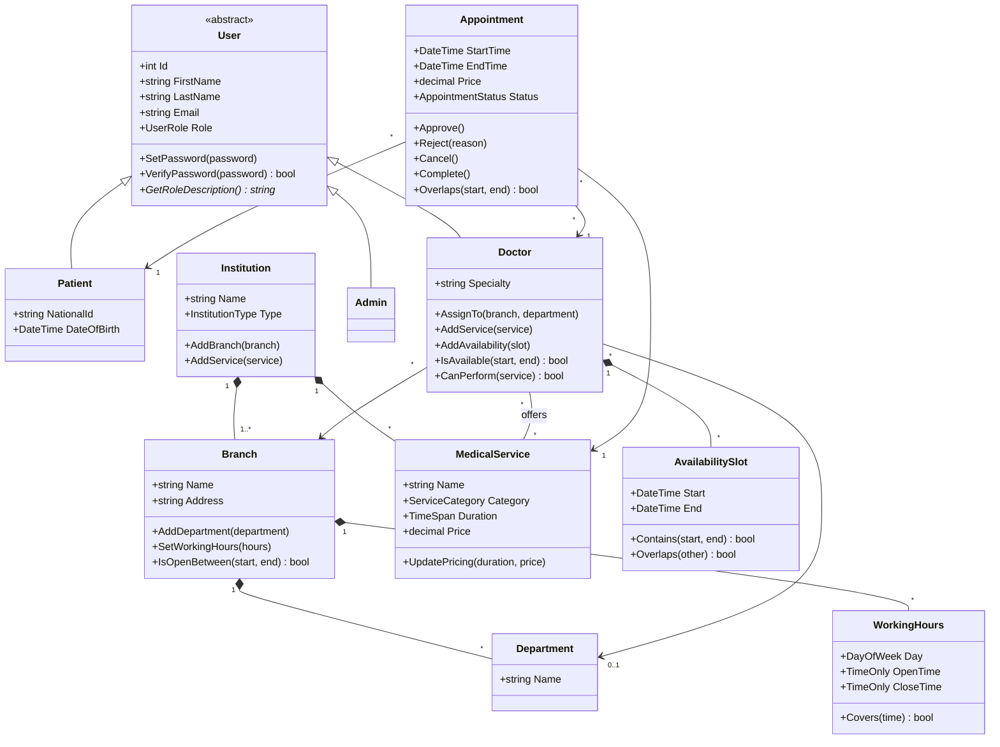
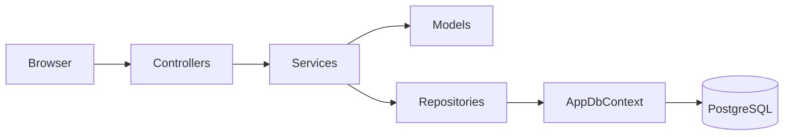

# MediPoint – Hospital Appointment System

A web-based hospital and clinic appointment system developed as an **Object-Oriented Programming** course project. It supports both single clinics and multi-branch healthcare institutions.

> The source code is written in English, while the user interface is in **Turkish**, since the application targets Turkish users.

## Screenshots

| Home | Booking |
|---|---|
|  |  |

| Doctor Panel | Admin Panel |
|---|---|
|  |  |

## Features

**Patient**
- Self-registration and login
- Step-by-step booking: branch → service → doctor → date → available time
- Only conflict-free time slots are offered
- Appointment history with status tracking and cancellation

**Doctor**
- Approve or reject (with a reason) pending appointment requests
- Mark approved appointments as completed
- Manage personal availability slots

**Admin**
- Manage institutions (hospital/clinic) and their branches
- Define departments and weekly working hours for each branch
- Define medical services with duration and price
- Register doctors and assign them to branches, departments and services

**Business rules**
- An appointment must fit within the branch's working hours and the doctor's availability
- No overlapping appointments for the same doctor or the same patient
- Appointment lifecycle: `Pending → Approved → Completed`, or `Rejected` / `Cancelled`
- The price is stored with the appointment, so later price changes do not affect existing appointments

## Object-Oriented Design

| Principle | Where it is used |
|---|---|
| **Abstraction** | `User` is an abstract class; `IAppointmentRepository` defines a contract without implementation |
| **Inheritance** | `Patient`, `Doctor` and `Admin` inherit from `User`; `AppointmentConflictException` inherits from `Exception` |
| **Polymorphism** | `GetRoleDescription()` and `DashboardController` are overridden by each user type; after login, each user is redirected to their own panel without any `if/else` on roles |
| **Encapsulation** | State changes only through methods with validation (`Appointment.Approve()`, `Doctor.AddAvailability()`, `MedicalService.UpdatePricing()`); collections and status fields have private setters |
| **Composition** | An `Institution` has `Branch`es; a `Branch` has `Department`s and `WorkingHours` |

The project also follows several **SOLID** principles: business logic lives in services (*Single Responsibility*), new user types can be added without changing the login code (*Open/Closed*), and `AppointmentService` depends on the `IAppointmentRepository` abstraction rather than on Entity Framework directly (*Dependency Inversion*).

### Class Diagram



### Architecture



## Technologies

- C# / ASP.NET Core MVC (.NET 8)
- Entity Framework Core 8
- PostgreSQL
- Bootstrap 5 and Bootstrap Icons

## Project Structure

```
HospitalAppointmentSystem.Web/
├── Models/         Domain classes and business rules
├── Services/       Application logic (booking, conflict checking, management)
├── Repositories/   Data access abstraction and EF Core implementation
├── Data/           AppDbContext and seed data
├── Migrations/     Database schema history
├── ViewModels/     Data shapes for forms and pages
├── Helpers/        Display helpers and model binders
├── Controllers/    MVC controllers (Account, Patient, Doctor, Admin)
└── Views/          Razor pages
```

## How to Run

1. Install the [.NET 8 SDK](https://dotnet.microsoft.com/download) and [PostgreSQL](https://www.postgresql.org/download/).
2. Clone the repository.
3. Install the EF Core command-line tool:
```bash
   dotnet tool install --global dotnet-ef
```
4. Set your database connection (inside the `HospitalAppointmentSystem.Web` folder):
```bash
   dotnet user-secrets set "ConnectionStrings:DefaultConnection" "Host=localhost;Port=5432;Database=hospital_appointment;Username=postgres;Password=YOUR_PASSWORD"
```
   Adjust the port and password to match your PostgreSQL installation.
5. Run the application:
```bash
   dotnet run
```
   The database and its tables are created automatically on first run, and demo data is added.

## Demo Accounts

| Role | Email | Password |
|---|---|---|
| Admin | admin@hospital.com | Admin123! |
| Doctor | ebru.yazici@hospital.com | Doctor123! |
| Doctor | mehmet.kaya@hospital.com | Doctor123! |
| Doctor | zeynep.demir@hospital.com | Doctor123! |
| Patient | patient@test.com | Patient123! |
