# MediPoint – Hospital Appointment System

A web-based hospital and clinic appointment system developed as an **Object-Oriented Programming** course project. It supports both single clinics and multi-branch healthcare institutions, with seven user types organized in a multi-level class hierarchy.

> The source code is written in English, while the user interface is in **Turkish**, since the application targets Turkish users.

## Screenshots

### Welcome and Authentication

| Home | Login |
|---|---|
| 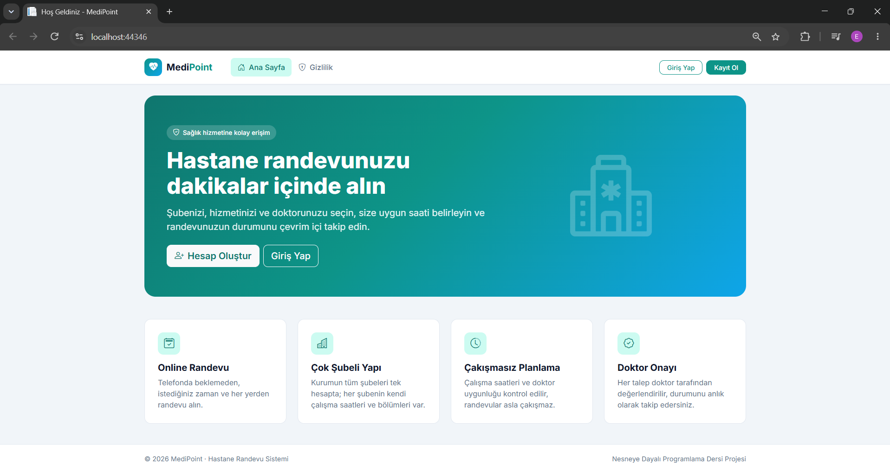 | 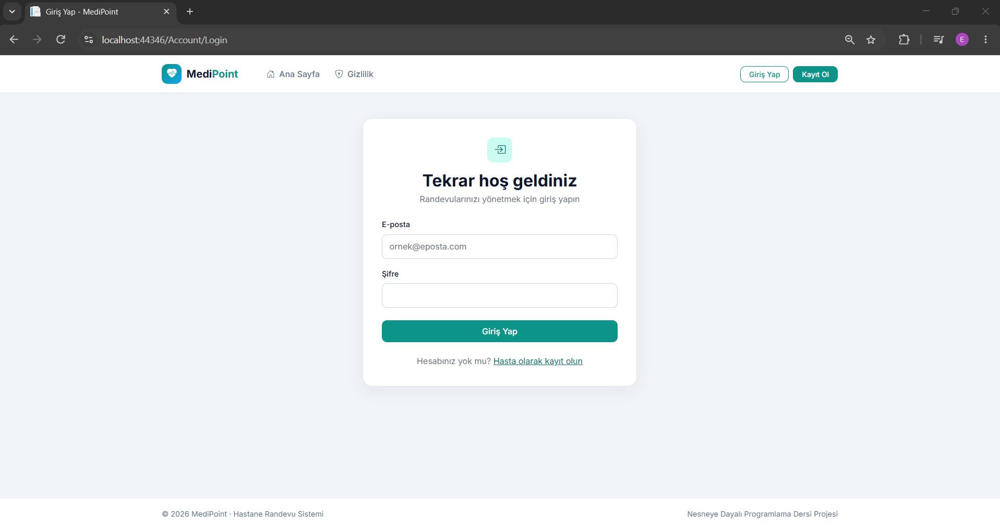 |

| Sign Up |  |
|---|---|
| 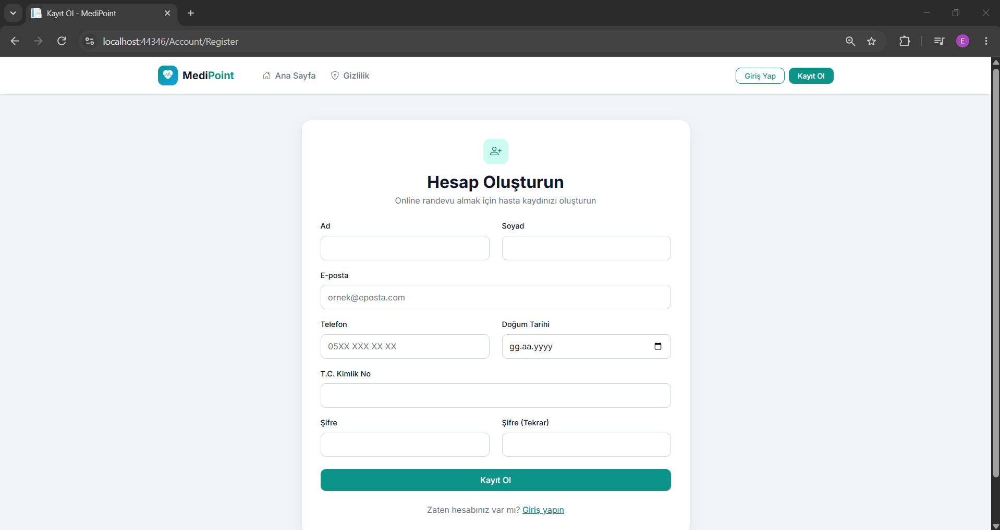 |  |

### Patient

| Booking | Test Result |
|---|---|
| 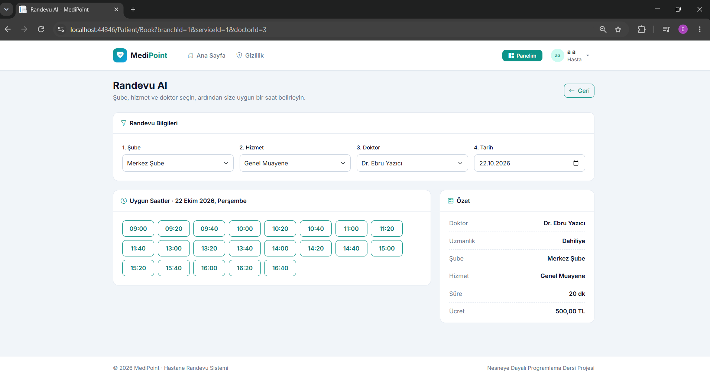 | 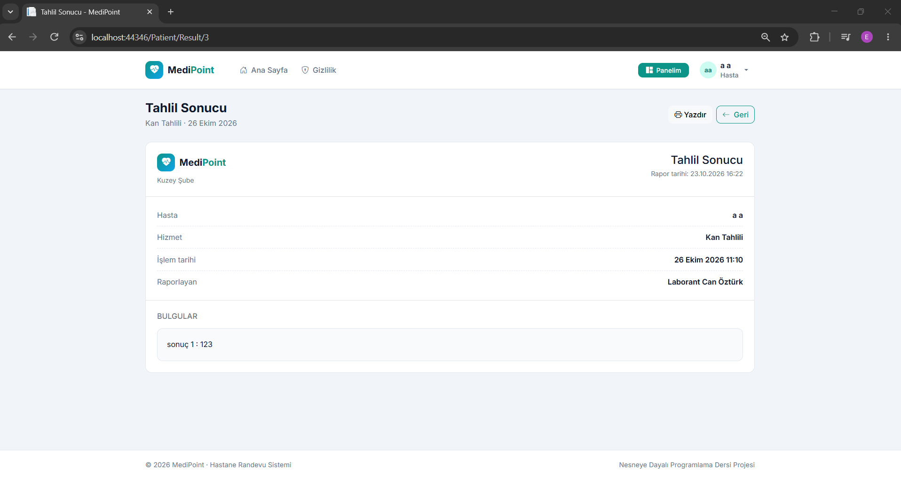 |

### Doctor and Secretary

| Doctor Panel | Secretary Panel |
|---|---|
| 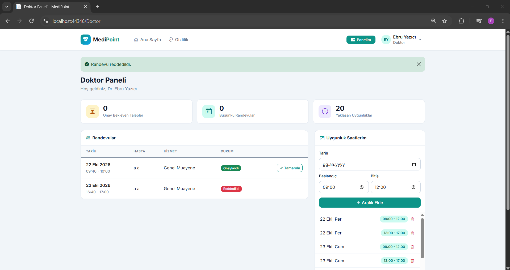 | 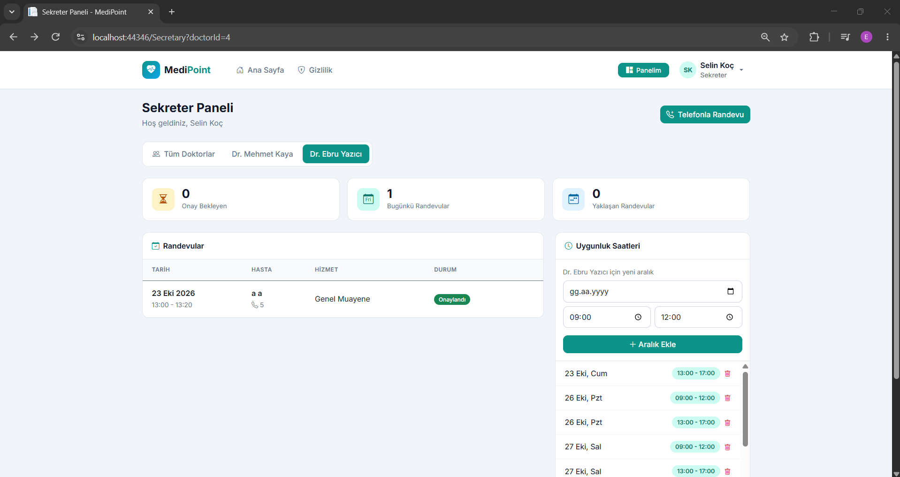 |

| Phone Booking by Secretary |  |
|---|---|
| 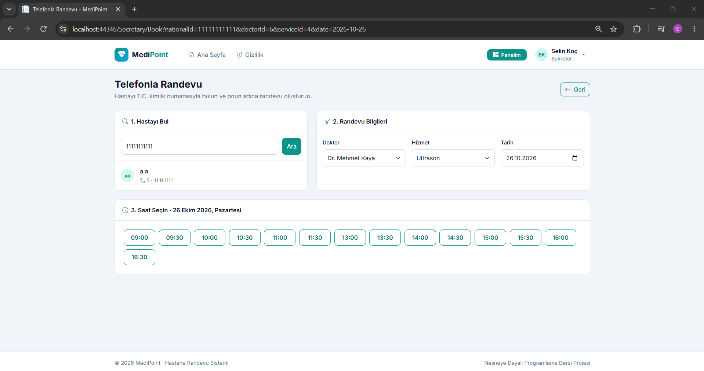 |  |

### Admin

| Dashboard | Staff Management |
|---|---|
| 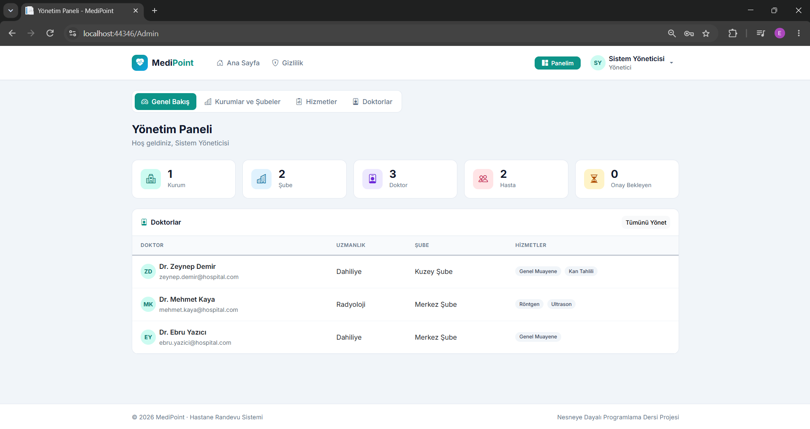 | 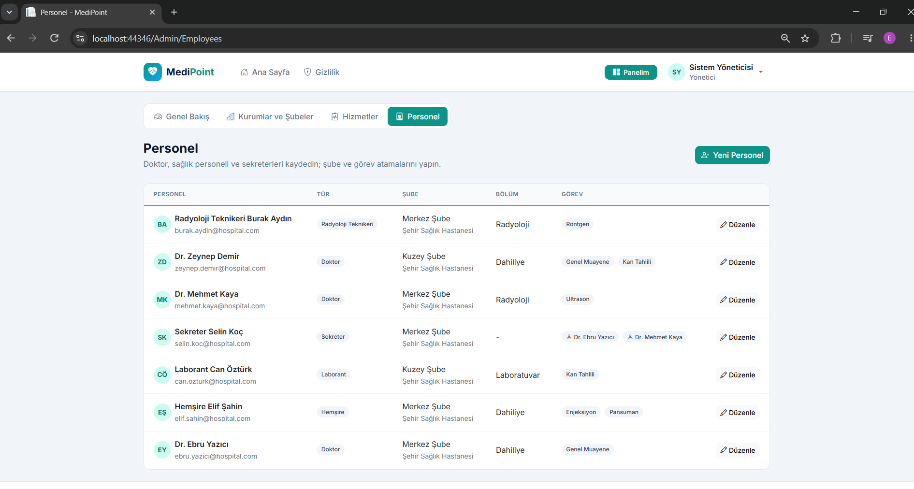 |

| Medical Services |  |
|---|---|
| 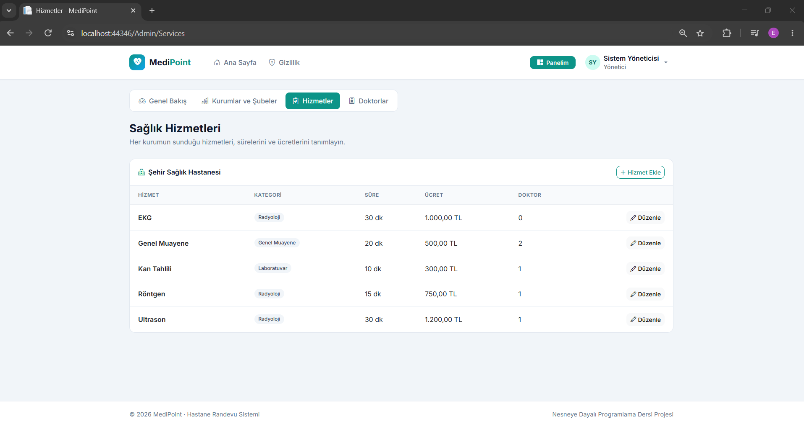 |  |

## Features

**Patient**
- Self-registration and login
- Step-by-step booking: branch → service → healthcare professional → date → available time
- Only conflict-free time slots are offered
- Appointment history with status tracking and cancellation
- Viewing and printing laboratory and imaging results

**Doctor and health staff** (nurse, radiology technician, lab technician)
- Approve, reject (with a reason) and complete appointments
- Manage personal availability slots
- Lab and radiology technicians can enter results for completed appointments
- Each type can only offer services in its own field (e.g. a lab technician cannot be assigned an X-ray)

**Secretary**
- Assigned to one or more doctors in the same branch
- Sees the assigned doctors' appointments with patient contact details
- Approves or rejects appointment requests and manages the doctors' availability
- Books appointments on behalf of patients (phone booking), found by national ID

**Admin**
- Manages institutions (hospital/clinic), branches, departments and weekly working hours
- Defines medical services with category, duration and price
- Registers all staff types and assigns them to branches, departments, services or doctors
- Clickable dashboard cards leading to detailed lists
- Patient list with masked national IDs and appointment counts
- Appointment list filterable by status and patient

**Business rules**
- An appointment must fit within the branch's working hours and the professional's availability
- No overlapping appointments for the same professional or the same patient
- Appointment lifecycle: `Pending → Approved → Completed`, or `Rejected` / `Cancelled` / `Expired`
- The price is stored with the appointment, so later price changes do not affect existing appointments
- An appointment cannot be completed (and no result can be entered) before its start time
- A pending request whose time has passed is shown as **Expired** and can no longer be approved or rejected; this status is derived from the current time rather than stored

## Object-Oriented Design

| Concept | Where it is used |
|---|---|
| **Abstraction** | `User`, `Staff`, `HealthcareProfessional` and `HealthStaff` are abstract; `IAppointmentManager`, `IResultEntry` and `IAppointmentRepository` define contracts without implementation |
| **Multi-level inheritance** | Up to four levels: `LabTechnician → HealthStaff → HealthcareProfessional → Staff → User`. Shared behavior is written once at the right level (e.g. branch assignment in `Staff`, services and availability in `HealthcareProfessional`) |
| **Polymorphism** | `CanOffer()` decides which services each type may offer; `Title` builds each `DisplayName` ("Dr. …", "Laborant …"); `DashboardController` sends each user to the right panel; `GetRoleDescription()` describes each role |
| **Interfaces as capabilities** | `IResultEntry` is implemented only by the technicians, so a nurse (a sibling class) cannot write results. `IAppointmentManager` is implemented by two different branches of the hierarchy (`HealthcareProfessional` and `Secretary`), and `AppointmentService` asks `CanManage()` instead of checking roles |
| **Encapsulation** | State changes only through validating methods (`Appointment.Approve()`, `HealthcareProfessional.AddService()`, `Secretary.AssignDoctor()`); collections and status fields have private setters |
| **`sealed override`** | `HealthStaff` seals `CanOffer()`; subclasses only declare their `AllowedCategory` and cannot change the rule itself |
| **Composition** | An `Institution` has `Branch`es; a `Branch` has `Department`s and `WorkingHours` |
| **Factory pattern** | `StaffFactory.Create(type)` decides which concrete class to instantiate when an admin registers a new employee |
| **Generics** | The seeder's `Setup<T>() where T : HealthcareProfessional` creates any professional type with one method |

The project also follows **SOLID** principles: business logic lives in services (*Single Responsibility*); new staff types can be added without changing the booking or approval code (*Open/Closed*); `AppointmentService` works with any `HealthcareProfessional` subtype (*Liskov Substitution*); and services depend on abstractions such as `IAppointmentRepository` and `IAppointmentManager` (*Dependency Inversion*).

### User Hierarchy and Interfaces

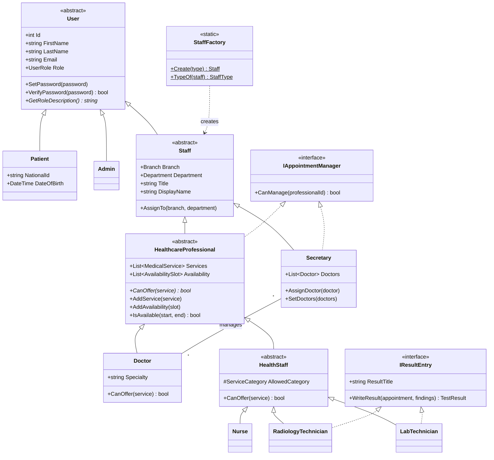

### Domain Model

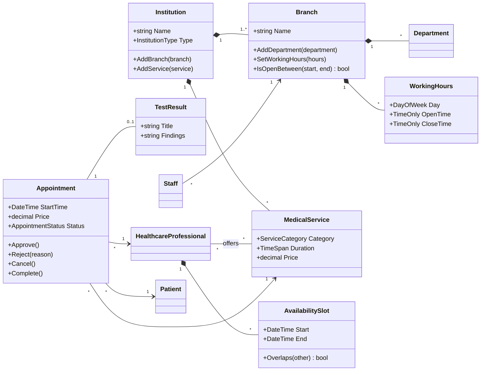

### Architecture

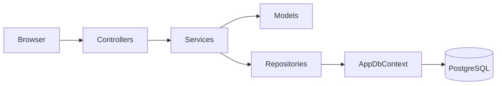

All user types are stored in a single `Users` table using Entity Framework's **Table-per-Hierarchy** mapping; a `UserType` column stores the concrete class, while `Role` stores the authorization group.

## Technologies

- C# / ASP.NET Core MVC (.NET 8)
- Entity Framework Core 8
- PostgreSQL
- Bootstrap 5 and Bootstrap Icons

## Project Structure

```
HospitalAppointmentSystem.Web/
├── Models/         Domain classes, interfaces, business rules and StaffFactory
├── Services/       Application logic (booking, conflict checking, results, management)
├── Repositories/   Data access abstraction and EF Core implementation
├── Data/           AppDbContext and seed data
├── Migrations/     Database schema history
├── ViewModels/     Data shapes for forms and pages
├── Helpers/        Display helpers and model binders
├── Controllers/    Account, Patient, Professional, Secretary and Admin controllers
└── Views/          Razor pages
```

## How to Run

1. Install the [.NET 8 SDK](https://dotnet.microsoft.com/download) and [PostgreSQL](https://www.postgresql.org/download/).
2. Clone the repository.
3. Install the EF Core command-line tool:
```bash
   dotnet tool install --global dotnet-ef
```
4. Set your database connection (inside the `HospitalAppointmentSystem.Web` folder):
```bash
   dotnet user-secrets set "ConnectionStrings:DefaultConnection" "Host=localhost;Port=5432;Database=hospital_appointment;Username=postgres;Password=YOUR_PASSWORD"
```
   Adjust the port and password to match your PostgreSQL installation.
5. Run the application:
```bash
   dotnet run
```
   The database and its tables are created automatically on first run, and demo data is added.

## Demo Accounts

| Role | Email | Password |
|---|---|---|
| Admin | admin@hospital.com | Admin123! |
| Doctor | ebru.yazici@hospital.com | Doctor123! |
| Doctor | mehmet.kaya@hospital.com | Doctor123! |
| Doctor | zeynep.demir@hospital.com | Doctor123! |
| Nurse | elif.sahin@hospital.com | Staff123! |
| Radiology Technician | burak.aydin@hospital.com | Staff123! |
| Lab Technician | can.ozturk@hospital.com | Staff123! |
| Secretary | selin.koc@hospital.com | Staff123! |
| Patient | a@gmail.com | 123456 |